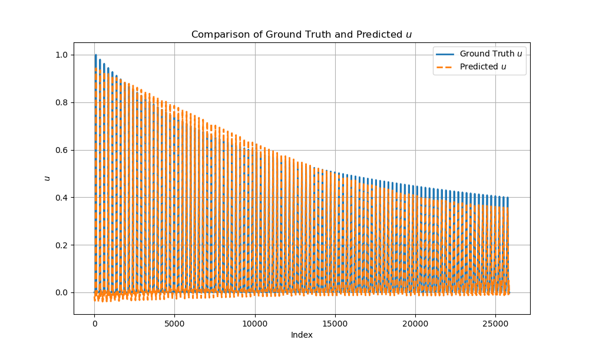

# Equation Discovery in ML

**Discover governing equations from data** — comparing physics-informed deep learning, sparse identification, and symbolic regression on PDE benchmarks and industrial time series.

This repository is a hands-on exploration of modern equation-discovery methods: how they recover interpretable dynamics, where they shine, and how they behave on real clamping-force / VDC measurements.

<p align="center">
  
</p>
<p align="center"><em>Burgers’ equation — PiDL field reconstruction vs ground truth</em></p>

---

## Why this exists

Classical ML predicts well but rarely tells you *what law* the system follows. Equation discovery aims for models you can read:

| Method | Idea | In this repo |
|--------|------|--------------|
| **PiDL** | PINN approximates the field; sparse regression (STRidge) selects PDE/ODE terms | Primary thread — Burgers’ + industrial CSVs |
| **PySINDy** | Sparse identification of nonlinear dynamics | Tutorials + trials |
| **PySR** | Genetic / symbolic regression | Burgers’ & tabular experiments |
| **PINNs** | Physics-informed neural nets (data-driven vs physics-informed) | Teaching examples |

Core PiDL reference: Chen, Liu & Sun, *Physics-informed deep learning of equations* ([`papers/PiDL.pdf`](papers/PiDL.pdf)).

---

## Highlights

- **Benchmark:** sparse recovery of Burgers’ dynamics with archived run logs and plots under [`results/burgers-pidl/`](results/burgers-pidl/)
- **Industrial:** dozens of PiDL runs on clamping-force / SWE_VDC series under [`results/industrial/`](results/industrial/)
- **Side-by-side methods:** notebooks for PiDL, SINDy, PySR, and PINNs
- **Background:** conceptual notes in [`notebooks/notes/Notes.ipynb`](notebooks/notes/Notes.ipynb)

<p align="center">
  
</p>
<p align="center"><em>Industrial series — predicted vs measured trajectories (term experiment)</em></p>

---

## Repository layout

```text
.
├── data/
│   ├── burgers/          # Burgers .mat/.csv + misc tabular samples
│   ├── industrial/       # Clamping-force & VDC CSVs
│   └── reconstructed/    # Synthesized rows consistent with discovered formulas
├── notebooks/
│   ├── pidl/             # PiDL experiments (Torch & industrial)
│   ├── pysindy/          # SINDy trials
│   ├── pysr/             # PySR / symbolic regression
│   ├── pinns/            # PINN demos
│   └── notes/            # Background & misc notebooks
├── scripts/
│   ├── pidl/burgers/     # Burgers PiDL training scripts
│   ├── pidl/industrial/  # Industrial PiDL / EqD scripts
│   ├── pinns/            # Short PINN examples
│   └── utils/            # Data reconstruction & helpers
├── tutorials/pysindy/    # Upstream-style SINDy intros
├── results/              # All experiment artifacts (kept in full)
│   ├── burgers-pidl/
│   ├── industrial/       # output_* run folders
│   ├── root-term/        # Standalone term-run plots & .mat dumps
│   ├── pysr-hall-of-fame/
│   ├── training-runs/
│   └── misc/
├── papers/               # Reference PDFs
├── requirements.txt      # Portable install set
└── requirements.windows-freeze.txt  # Original Windows env freeze
```

Every previous plot, `.mat`, and run folder is retained — only relocated for clarity.

---

## Quick start

```bash
# Python 3.10+ recommended
python -m venv .venv
source .venv/bin/activate   # Windows: .venv\Scripts\activate

pip install -r requirements.txt
```

Optional extras:

- **PySR** needs a working Julia install ([PySR docs](https://astroautomata.com/PySR/)).
- **PiDL industrial scripts** use TensorFlow (compat v1 graph mode).

Browse results without training:

```bash
# Burgers gallery
open results/burgers-pidl/u_comparison_line.png

# Industrial run folder (example)
ls results/industrial/new_output_2/
```

---

## Explore by path

### 1. Read the story
- [`notebooks/notes/Notes.ipynb`](notebooks/notes/Notes.ipynb) — equation discovery vs classical ML
- [`papers/PiDL.pdf`](papers/PiDL.pdf), [`papers/long24a.pdf`](papers/long24a.pdf)

### 2. Burgers’ with PiDL
- Scripts: [`scripts/pidl/burgers/`](scripts/pidl/burgers/)
- Data: [`data/burgers/burgers.mat`](data/burgers/burgers.mat)
- Results: [`results/burgers-pidl/`](results/burgers-pidl/) (includes `stdout.txt` with discovered PDE coefficients)

### 3. Industrial clamping-force / VDC
- Scripts: [`scripts/pidl/industrial/`](scripts/pidl/industrial/) — start with `PiDL_EqD.py`, `EqD_4.py`–`EqD_6.py`, `eqd_sym_term_try3.py`
- Data: [`data/industrial/`](data/industrial/)
- Notebook: [`notebooks/pidl/Eqd_pidl.ipynb`](notebooks/pidl/Eqd_pidl.ipynb)
- Results: [`results/industrial/`](results/industrial/)

### 4. SINDy / PySR / PINNs
- Tutorials: [`tutorials/pysindy/`](tutorials/pysindy/)
- Trials: [`notebooks/pysindy/`](notebooks/pysindy/), [`notebooks/pysr/`](notebooks/pysr/), [`notebooks/pinns/`](notebooks/pinns/)
- PINN scripts: [`scripts/pinns/`](scripts/pinns/)

---

## Running scripts (path note)

Many scripts were written against **Windows absolute paths** (e.g. `C:/Users/.../clamping_force.csv`). After this restructure, point loaders at the new relative locations, for example:

```python
# Industrial CSV
data = pd.read_csv("../../data/industrial/clamping_force.csv")

# Burgers MAT
data = scipy.io.loadmat("../../data/burgers/burgers.mat")
```

Run PiDL scripts from a fresh results directory so plots/logs land together:

```bash
mkdir -p results/industrial/my_run && cd results/industrial/my_run
python ../../../scripts/pidl/industrial/PiDL_EqD.py
```

---

## Methods at a glance

```text
Data ──► PINN / NN field approx ──► library of candidate terms
                                      │
                                      ▼
                              STRidge / SINDy / PySR
                                      │
                                      ▼
                           Sparse governing equation
```

PiDL couples a deep surrogate of the solution with sparse coefficient selection so the recovered equation stays interpretable while fitting noisy or partial observations.

---

## License

MIT — see [`LICENSE`](LICENSE).
