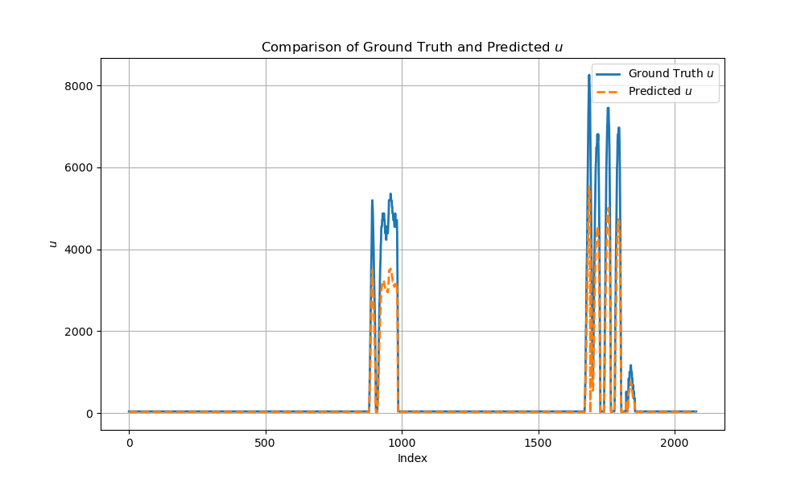

# Equation Discovery in ML

**Discover governing equations from data** — comparing physics-informed deep learning, sparse identification, and symbolic regression on PDE benchmarks and industrial time series.

This repository is organized **problem-first**: explore methods on the Burgers benchmark, then on industrial clamping-force / VDC measurements.

<p align="center">
  
</p>
<p align="center"><em>Burgers’ equation — PiDL field reconstruction vs ground truth</em></p>

---

## Why this exists

Classical ML predicts well but rarely tells you *what law* the system follows. Equation discovery aims for models you can read:

| Method | Idea | Where in this repo |
|--------|------|--------------------|
| **PiDL** | PINN approximates the field; sparse regression (STRidge) selects PDE/ODE terms | [`experiments/burgers/pidl/`](experiments/burgers/pidl/), [`experiments/industrial/pidl/`](experiments/industrial/pidl/) |
| **PySINDy** | Sparse identification of nonlinear dynamics | [`experiments/burgers/sindy/`](experiments/burgers/sindy/), [`examples/pysindy/`](examples/pysindy/) |
| **PySR** | Genetic / symbolic regression | [`experiments/burgers/pysr/`](experiments/burgers/pysr/) |
| **PINNs** | Physics-informed neural nets (data-driven vs physics-informed) | [`experiments/burgers/pinns/`](experiments/burgers/pinns/) |

Core PiDL reference: Chen, Liu & Sun, *Physics-informed deep learning of equations* ([`docs/papers/PiDL.pdf`](docs/papers/PiDL.pdf)).

---

## Highlights

- **Benchmark:** sparse recovery of Burgers’ dynamics under [`results/burgers/pidl/`](results/burgers/pidl/)
- **Industrial:** dozens of PiDL runs under [`results/industrial/pidl/archive/`](results/industrial/pidl/archive/)
- **Side-by-side methods** on Burgers: PiDL, SINDy, PySR, and PINNs in [`experiments/burgers/`](experiments/burgers/)
- **Background:** [`docs/notes/Notes.ipynb`](docs/notes/Notes.ipynb)

<p align="center">
  
</p>
<p align="center"><em>Industrial series — predicted vs measured trajectories (term experiment)</em></p>

---

## Repository layout

```text
.
├── docs/
│   ├── papers/                      # Reference PDFs
│   └── notes/                       # Conceptual notebooks
├── data/
│   ├── benchmarks/burgers/          # Burgers .mat / CSV only
│   ├── applications/industrial/     # Clamping-force & VDC CSVs
│   ├── tabular/                     # Housing, wine, automobile samples
│   └── reconstructed/               # Rows synthesized from discovered formulas
├── experiments/                     # Spine: problem → method
│   ├── burgers/
│   │   ├── pidl/
│   │   ├── pysr/
│   │   ├── sindy/
│   │   └── pinns/
│   └── industrial/
│       └── pidl/
├── examples/pysindy/                # Upstream-style SINDy intros
├── tools/                           # Reconstruction helpers
├── results/                         # Mirrors experiments/ (all artifacts kept)
│   ├── burgers/pidl/
│   ├── burgers/pysr/
│   └── industrial/pidl/
│       ├── term-library/
│       ├── archive/                 # output_* run folders
│       └── misc/
├── requirements.txt
└── requirements.windows-freeze.txt
```

Every previous plot, `.mat`, and run folder is retained — only relocated for clarity.

---

## Quick start

```bash
# Python 3.10+ recommended
python -m venv .venv
source .venv/bin/activate   # Windows: .venv\Scripts\activate

pip install -r requirements.txt
```

Optional extras:

- **PySR** needs a working Julia install ([PySR docs](https://astroautomata.com/PySR/)).
- **PiDL industrial scripts** use TensorFlow (compat v1 graph mode).

Browse results without training:

```bash
# Burgers gallery
open results/burgers/pidl/u_comparison_line.png

# Industrial run folder (example)
ls results/industrial/pidl/archive/new_output_2/
```

---

## Explore by path

### 1. Read the story
- [`docs/notes/Notes.ipynb`](docs/notes/Notes.ipynb) — equation discovery vs classical ML
- [`docs/papers/PiDL.pdf`](docs/papers/PiDL.pdf), [`docs/papers/long24a.pdf`](docs/papers/long24a.pdf)

### 2. Burgers’ benchmark
- Experiments: [`experiments/burgers/`](experiments/burgers/) — start with [`pidl/`](experiments/burgers/pidl/)
- Data: [`data/benchmarks/burgers/burgers.mat`](data/benchmarks/burgers/burgers.mat)
- Results: [`results/burgers/pidl/`](results/burgers/pidl/) (includes `stdout.txt` with discovered PDE coefficients)

### 3. Industrial clamping-force / VDC
- Experiments: [`experiments/industrial/pidl/`](experiments/industrial/pidl/) — start with `PiDL_EqD.py`, `EqD_4.py`–`EqD_6.py`, `eqd_sym_term_try3.py`
- Data: [`data/applications/industrial/`](data/applications/industrial/)
- Notebook: [`experiments/industrial/pidl/Eqd_pidl.ipynb`](experiments/industrial/pidl/Eqd_pidl.ipynb)
- Results: [`results/industrial/pidl/archive/`](results/industrial/pidl/archive/), term runs in [`term-library/`](results/industrial/pidl/term-library/)

### 4. Examples & tools
- SINDy tutorials: [`examples/pysindy/`](examples/pysindy/)
- Helpers: [`tools/`](tools/)

---

## Running scripts (path note)

Many scripts were written against **Windows absolute paths** (e.g. `C:/Users/.../clamping_force.csv`). After this restructure, point loaders at the new relative locations, for example:

```python
# Industrial CSV (from experiments/industrial/pidl/)
data = pd.read_csv("../../../data/applications/industrial/clamping_force.csv")

# Burgers MAT (from experiments/burgers/pidl/)
data = scipy.io.loadmat("../../../data/benchmarks/burgers/burgers.mat")
```

Run PiDL scripts from a fresh results directory so plots/logs land together:

```bash
mkdir -p results/industrial/pidl/archive/my_run && cd results/industrial/pidl/archive/my_run
python ../../../../../experiments/industrial/pidl/PiDL_EqD.py
```

---

## Methods at a glance

```text
Data ──► PINN / NN field approx ──► library of candidate terms
                                      │
                                      ▼
                              STRidge / SINDy / PySR
                                      │
                                      ▼
                           Sparse governing equation
```

PiDL couples a deep surrogate of the solution with sparse coefficient selection so the recovered equation stays interpretable while fitting noisy or partial observations.

---

## License

MIT — see [`LICENSE`](LICENSE).
